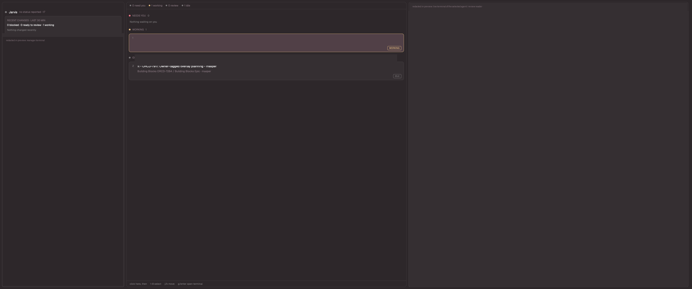

# Conductor

A three-column Herdr layout for managing many agents from one session. On the left the manager's own terminal; in the middle agents as flight strips grouped into bays by what they need; on the right a reader for the selected strip. Dark warm palette (Dr Pepper theme).

## What you see

Left to right, with 8px padding and gaps, rounded 10px panels with 1px `border`:
- **Left** (weight 3, 280-520px): a 132px header (`window_drag`, leaves room for macOS traffic lights at `[14,14]`): a status dot and "Jarvis", the manager terminal's reported state (or "no status reported") and address, and a card "RECENT CHANGES · LAST 30 MIN" with counts of blocked, ready to review and working agents plus up to four agents whose status changed in the last 30 minutes. Under it the manager terminal.
- **Centre** (weight 5, min 380): a 30px count bar (need you / working / review / idle), then bays NEEDS YOU (always shown, "Nothing waiting on you" when empty), WORKING, REVIEW READY, IDLE (empty bays hidden), then a 26px key hint bar. Each strip is a rounded 8px card, 4px status-coloured bar on its left, number 1-8, bold name, age on the right, a second line (blocked: dialog title in `blocked` colour; others: space / tab and folder name), a third line with the latest event ("finished 3m ago · turn 4") and a bordered tag (status word; blocked adds the kind). Blocked strips are indented 14px. The selected strip uses `selected` background and a status-coloured border.
- **Right** (weight 5, min 320): a 40px header (status dot, name, status, button "Go to session", or "Back"), then a stack: the reader, or the agent's live terminal.

With no agents the centre shows "No agents running" and a one-line explanation.

## How it behaves

- `blocked`: pulsing bar (native opacity loop 0.35-1 over 1400 ms), reader shows DIALOG (title and kind from the agent's own report) and the last terminal lines via a throttled `hc read`; button "Go to session" runs `terminal.peek`.
- `working`: bar loops opacity 0.55-1 over 3200 ms; right shows the live terminal.
- `done` (REVIEW READY): still; reader shows the last status message, `git status --short`, `git diff --stat` for the agent's folder (refreshed every 8 s), and a note that verification badges are not available.
- `idle`: still; live terminal.
- Keys (after clicking the centre column): `1`-`8` select, `j`/`down` next, `k`/`up` previous, `g`/`enter` open the terminal. Clicking a strip selects it.
- The mod calls `setAgentOrder` with the strips' order so `agent.next`/`agent.prev` follow it.

## Built from

- `layouts/conductor.json`: root `column` (top bar 36px, body row, foot 28px), `titlebar: none`, `theme: dr-pepper`, `preview: layouts/conductor.svg`. Body children: column `host` (weight 4, min 300; blocks `host-head` 256px `{role: host}` and `manager` `{role: slot}` placeholder, which `install.sh --manager tN` replaces by `{"terminal":"tN"}`), block `strips` (`role: strips`), column `right` (block `right-head` `role: head`, block `detail` `role: detail`). No terminal is embedded by default and the board never calls `agent.focus` or `layout.select`.
- `mods/conductor-board/` (`main.js`, `logic.js`, `mod.json` `{"place":"none"}`): one mod, seven roles by `props().role`. Props: `manager`, `wave` (false disables the waveform), `peek` (false disables reading other sessions' text), `voice_file`, `demo`. Uses `agents()`, `terminals()`, `panes()`, `spaces()`, `theme()`, `shared`, `run("terminal.peek")`, `run("tab.new")`, `readTextFile` (voice file), `exec("git", ["--no-optional-locks", "-C", cwd, ...])`, `hc(["read", t, "--lines", "30"])`, `setAgentOrder`, `.loop(...)`, `.transition(...)`. All commands go through `SafeRunner` (see README Safeguards).
- `themes/dr-pepper.json` colours by theme name (`chrome`, `surface`, `selected`, `blocked`, `working`, `done`, `accent`, ...). No images.

## Watch out

- The `terminals()` status record's shape (`report`, `status_ms`) is read defensively; if absent, ages and messages are blank.
- Keys need the centre column focused (click it); there is no global binding.
- The right pane shows a read-only text snapshot for working/idle agents, never a live terminal.
- The strip count shown by numbers stops at 8; more are reachable with `j`/`k`.
- Needs `git` on the agent's machine; remote spaces run git there through `exec(..., {on})`.
- Not built: verification badges, test counts, summaries, voice waveform, authority tag, approve/hold, `cmd-k`.

## Done when

- `herdr-app check` passes for `conductor-board` and `herdr-app status` shows no errors after `layout.switch conductor`.
- With no agents, the centre shows the empty state and no errors.
- A `blocked` agent appears in NEEDS YOU, offset, with its dialog title; selecting it shows the reader; "Go to session" shows its terminal.
- A `done` agent shows git status and diff stat of its folder.
- A `working`/`idle` agent selected shows its live terminal on the right.
- `ctrl-shift-l` switches away and back.

## Fidelity pass (v2)

Layout is now a column: 36px top bar (brand, layout name, status chips), a `body` row (12px padding and gap, 8px radius panels on `surface` with `selection`-coloured border), 28px key-hint footer. `ui_font` is JetBrains Mono; type scale 11/13/15 and spacing 4/8/12/16 as in the HTML mock. Strips: coloured border plus 3px left bar, bold accent name, soft task, muted mono thread line, event line with tag; blocked strips step in 8px (native cannot rotate). Status colours use ANSI slots 1/6/2 of the theme because the theme's own `working`/`done` differ from the mock.

Not possible natively: letter-spacing, `text-transform` (labels are uppercased in code), rotation, gradients (the Jarvis tile's radial glow), box-shadow pulse (an opacity loop on the bar stands in), inline rich text inside truncation, the voice orb and push-to-talk, `Approve & send` / `Hold` (the board deliberately never answers dialogs), AUTO/ASK/READ policy tags and verified badges (no such data), drag between bays.

## New session

Top bar: a small `selected`-coloured "+ New session" button left of the status chips; key `n` on the board does the same, and the footer lists it. It runs `tab.new {name: "new pi", argv: ["pi"], folder?}`. Unverified in the running app (only `herdr-app check`).
